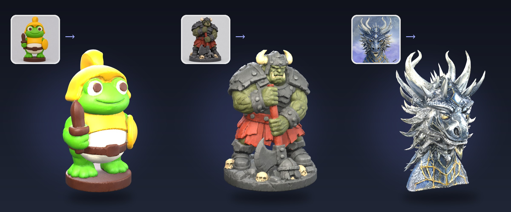
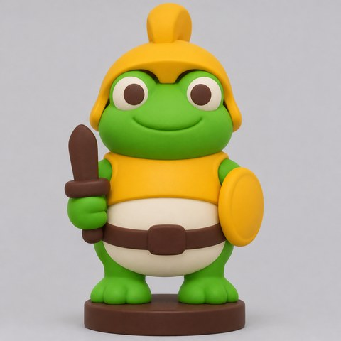
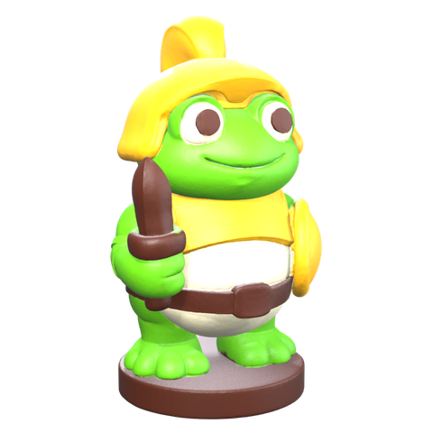
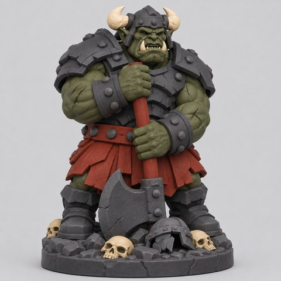
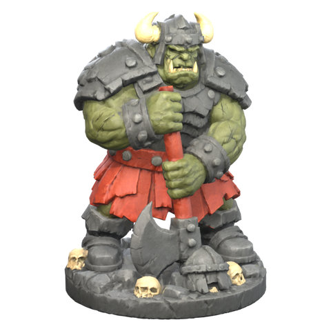
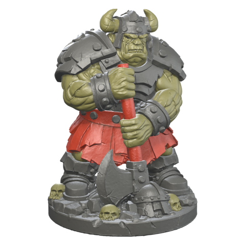
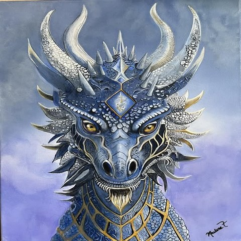
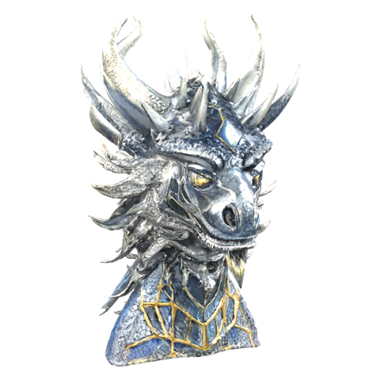
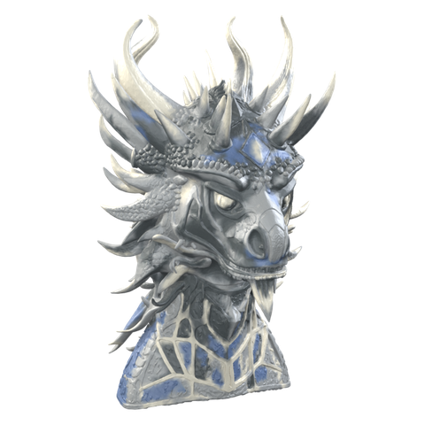
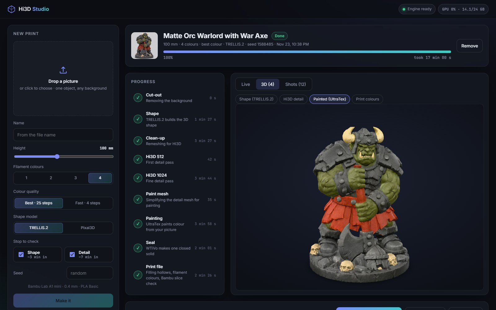

<div align="center">

# Hi3D Studio

**One picture in. A detailed, multi-colour 3D print out.**

A local web app for Windows that turns a single image into a watertight, filament-coloured
Bambu Studio project — shape, fine detail, painting, sealing, colour reduction and a slice
check, with live previews and checkpoints so you never wait 30 minutes for a bad result.



</div>

## What it does

| Picture | Painted 3D model | As it prints (4 filaments) |
|:---:|:---:|:---:|
|  |  |  |
|  |  |  |
|  |  |  |

All three were made with the default settings: 100 mm tall, 4 colours, Bambu Lab A1 mini.

| | Frog Knight | Orc Warlord | Dragon |
|---|---|---|---|
| Picture → print file | 14.8 min | 17.0 min | ~25 min (both checkpoints) |
| Print time (Bambu slice check) | 21.0 h | 25.9 h | 38.8 h |
| Colour changes | 640 | 828 | 1,299 |
| Filament (in the model) | 289 g (55 g) | 242 g (79 g) | 344 g (56 g) |

The frog and the orc were generated with the prompts in [docs/PROMPTS.md](docs/PROMPTS.md);
the dragon is a hand-painted picture. Flat colours print much faster than painted shading.



## Features

- **Picture → print in one click**, about 15–20 minutes on an RTX-class 24 GB laptop GPU.
- **Live progress**: nine stages with their own progress and timings, an overall ETA, progress shots
  (cut-out, UltraTex's painted views) and a 3D viewer that adds each model as it is made.
- **Checkpoints**: optional stops after the *shape* (~3 min) and the *detail* (~7 min). Continue,
  *try another* (re-run just that step with a new seed), or stop — before the long painting step.
- **Real print files**: the Hi3D detail mesh is sealed with WTiVo, enclosed hollows (open-bottomed
  busts, shells with windows) are filled solid automatically, colours are reduced to your filament
  count, and Bambu Studio builds and slices the project as a check.
- **Results that matter**: print time, colour changes, filament per colour in grams, size, slicer
  warnings — and an **Open in Bambu Studio** button.
- **History** of every job with its files, re-openable any time.

## Requirements

| | |
|---|---|
| OS | Windows 10 / 11 |
| GPU | NVIDIA, **16 GB+ VRAM** recommended (tested on a 24 GB RTX PRO 5000 laptop) |
| RAM | **32 GB+** (peaks around 33 GB during sealing and the print step) |
| Disk | ~60 GB (ComfyUI, PyTorch, ~33 GB of models) |
| Software | [Git for Windows](https://git-scm.com/download/win), [Bambu Studio](https://bambulab.com/en/download/studio) |
| Printer | Bambu Lab A1 mini with AMS lite out of the box (A1, P1S and X1C presets included) |

## Install

```powershell
git clone https://github.com/OzAILabs/hi3d-studio
```

Then double-click **`Setup.bat`**. It builds everything inside the repo folder and asks nothing:

1. Embedded Python 3.12.10, PyTorch 2.8.0 + CUDA 12.8, ComfyUI v0.46.0 (the versions MostAadTech's
   WTiVo watertight node is compiled for), Triton and the Python headers it needs.
2. AeroX's native Hi3D nodes, VisualBruno's ComfyUI-Trellis2 (CuMesh), PixelArtistry's
   Watertight-Meshes, Image-to-3D-Print and Animated-Characters packs (WTiVo, UltraTex) — each at
   the version its author tested — and this repo's **Hi3D-ColourPrint** node.
3. All models (~33 GB). Hi3D, TRELLIS.2, Pixal3D, MoGe, DINO, CLIP and BiRefNet are checked against
   their SHA-256.

It ends with a GPU self-test. Expect 30–60 minutes, mostly downloads. Safe to re-run.

## Use

1. Double-click **`Start Hi3D Studio.bat`** — the page opens at http://127.0.0.1:7870.
2. Drop a picture, pick height, filament colours, colour quality (Best = 25 steps, Fast = 4) and
   whether to stop at the checkpoints. Click **Make it**.
3. Watch the stages, previews and 3D models. At a checkpoint, spin the model and decide.
4. When it's done: **Open in Bambu Studio**, turn on supports if it says so, print.

The picture matters most — see **[Pictures that print well](docs/PROMPTS.md)** for the rules and
two ready-made prompts for an image generator (the frog and the orc above).

## How it works

```
picture ─► cut-out (BiRefNet) ─► shape (TRELLIS.2 or Pixal3D) ─► remesh ─► Hi3D 512 ─► Hi3D 1024
        ─► paint mesh ─► UltraTex painting (FLUX.2 Klein) ──┐
        ─► WTiVo seal ─► fill hollows ─► 1M faces ─► colours from the painting ─► filament colours
        ─► Bambu Studio project + slice check
```

| Stage | Typical time | |
|---|---|---|
| Cut-out | seconds | BiRefNet background removal |
| Shape | ~1.5 min | TRELLIS.2 at 1024 (Pixal3D selectable) |
| Clean-up | ~3 min | two remesh passes (AeroX's tip) |
| Hi3D 512 → 1024 | ~3 min | Hi3D adds hair-fine detail |
| Paint mesh | ~30 s | detail mesh simplified to 60k faces for painting |
| Painting | ~4 min | UltraTex paints colour from your picture, all the way round |
| Seal | ~2 min | WTiVo: one closed solid |
| Print file | ~2.5 min | hollows filled, colours copied, reduced to filaments, Bambu slice check |

The studio (`studio/`) is a small aiohttp server that runs ComfyUI hidden in the background and
drives the workflow through its API; the browser gets live state over Server-Sent Events. The
print step is a ComfyUI node in `comfyui_nodes/Hi3D-ColourPrint/`.

## Troubleshooting

| Symptom | Fix |
|---|---|
| UltraTex: *sparse backend unavailable* | Triton could not compile: re-run `Setup.bat` (it installs the Python headers Triton needs). |
| A job sits at one stage forever with no GPU use | Check `studio/comfyui.log`. The engine runs with UTF-8 output; WTiVo stalls if it can't print a character. |
| Port 7870 / 8189 already in use | Another studio or ComfyUI is running; close it or set `HI3D_STUDIO_PORT`. |
| Print takes 40 h | Colour changes drive print time. Fewer colours, larger colour areas, less painted shading (see the prompt guide), or a smaller print. |

## Credits and licences

The code in this repository is MIT-licensed. Hi3D Studio downloads and runs:

- **Hi3D v1.0** (OCEANO HK HOLDING LIMITED) via **AeroX's** native ComfyUI nodes and int8 weights — Hi3D Open License Agreement v1.0.
- **PixelArtistry** workflows and installers (MIT) — the Hi3D chain, remesh settings and pack setup this builds on.
- **MostAadTech**: WTiVo, LODTailor, Bake Forger, Fast Merge, Memory Cleaner and the low-VRAM **UltraTex** nodes.
- **UltraTex** (SIGGRAPH Asia 2026) on **FLUX.2 Klein base 9B** by Black Forest Labs — **FLUX Non-Commercial License v2.1**: the painting step is for non-commercial use.
- **TRELLIS.2** and **MoGe** by Microsoft, **Pixal3D** by Tsinghua University and Tencent ARC, **DINOv2/v3** by Meta, **CLIP** by OpenAI, **BiRefNet** — Comfy-Org repackagings.
- **VisualBruno**'s ComfyUI-Trellis2 (CuMesh), **ComfyUI**, **Bambu Studio** (CLI for project building and the slice check).

Each keeps its own licence; check them before commercial use.
